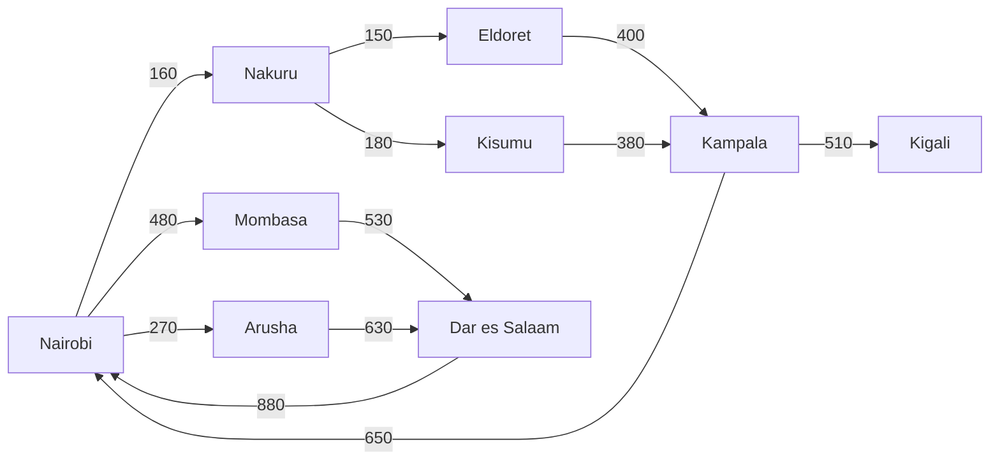

# Module 10: Graphs, Cycles & the `SEARCH` / `CYCLE` Clauses

**Level:** Advanced  |  **Time:** about 3 hours  |  **Files:** [`examples.sql`](examples.sql) · [`exercises.md`](exercises.md)

> **Requires PostgreSQL 14 or newer.** The `CYCLE` and `SEARCH` clauses were added in version 14. Everything else in this module works on older versions too.

## Learning objectives

By the end of this module you can:

- explain how a **graph** differs from a tree, and why that makes cycles a real danger,
- check reachability cheaply with `UNION`,
- enumerate routes safely with a **path check**, and explain why a depth limit alone is not enough,
- use the **`CYCLE`** clause to detect and flag loops,
- use the **`SEARCH`** clause for breadth-first and depth-first order,
- find a shortest route, and say honestly where recursive SQL stops being the right tool.

---

## 9.0 Where we are

Module 9 walked trees: every node had **one parent**, so a traversal from the root could never loop. Real networks (roads, flights, dependencies, links between pages) are different. A node can have **several parents**, and roads can lead back to where you started.

## 10.1 The routes graph

The `routes` table is a **directed graph**: each row is a **one-way road** from `origin` to `destination` with a length in kilometres.



| Term | Meaning here |
|---|---|
| **node** | a city |
| **edge** | a one-way road (a row of `routes`) |
| **weight** | the length, `distance_km` |
| **path (or walk)** | a sequence of roads, each starting where the last ended |
| **simple path** | a path that never visits the same city twice |
| **cycle** | a path that returns to a city it already visited |

Two things make this a graph and not a tree:

- **Several parents.** Dar es Salaam can be reached from Mombasa **or** from Arusha.
- **Cycles.** Nairobi to Nakuru to Eldoret to Kampala and back to Nairobi is a loop. There are four such loops from Nairobi.

## 10.2 Reachability: where can I get to?

If you only need to know **which cities can be reached**, not how, recursion ends by itself with `UNION`. Each round carries only a city name, so repeated cities are identical rows, and `UNION` discards rows it has already produced (Module 8):

```sql
WITH RECURSIVE reach(city) AS (
    SELECT 'Nairobi'::text
    UNION
    SELECT r.destination
    FROM reach c
    JOIN routes r ON r.origin = c.city
)
SELECT COUNT(*) AS reachable_cities FROM reach;      -- 9
```

All 9 cities are reachable from Nairobi (including Nairobi itself, by going round a loop). It is cheap and cycle-proof, but it throws away the *routes*. To get routes we must carry more per row, and then rows no longer repeat exactly, so `UNION` can no longer save us.

## 10.3 Enumerating routes, and the runaway

To list routes, carry the distance and the number of hops, starting from a start city:

```sql
WITH RECURSIVE walk(city, total_km, hops) AS (
    SELECT 'Nairobi'::text, 0, 0
    UNION ALL
    SELECT r.destination, w.total_km + r.distance_km, w.hops + 1
    FROM walk w
    JOIN routes r ON r.origin = w.city
)
SELECT COUNT(*) FROM walk WHERE city = 'Kigali';
```

On this graph it **never ends**: the walk goes round a loop, then round it again, forever. (Under `SET statement_timeout = '300ms'` it is cancelled: `canceling statement due to statement timeout`.) A tree could not do this, but a graph with a cycle can. We need a guard, and there are three common ones. Only one is really right.

## 10.4 Guard 1: a depth limit (it stops, but it lies)

```sql
... WHERE w.hops < 16       -- stop after 16 roads
```

The query now finishes, but look at how many "routes" to Kigali it reports as the limit grows:

```
 max_hops | walks_to_kigali | all_walks
----------+-----------------+-----------
        4 |               2 |        22
        8 |              10 |       128
       12 |              42 |       644
       16 |             202 |      3180
```

There are only **2 genuine routes** to Kigali. At 16 hops the query reports **202**, because every trip round a loop and onward counts as a new "route" (Nairobi, Nakuru, Eldoret, Kampala, Nairobi, Nakuru, ... Kigali). A depth limit is a good **safety net**, but it does not protect you from loops: it only decides when to give up, and the answer it gives is wrong.

## 10.5 Guard 2: a distance budget (it stops, but it still counts loops)

When every edge has a positive length, total distance only ever grows, so a budget must end the recursion:

```sql
... WHERE w.total_km + r.distance_km <= 2000
```

| Budget (km) | Walks to Kigali found |
|---|---|
| 1300 | 2 |
| 2000 | 2 |
| 3000 | 7 |
| 4000 | 18 |

Up to 2000 km the answer is right only **by luck**: the cheapest walk that contains a loop (a 1360 km round trip back to Nairobi, then 1220 km on to Kigali) costs 2,580 km, which does not fit. Once the budget passes that, loops creep in: at 3000 km there are 5 looping walks on top of the 2 genuine routes (7 in all), and at 4000 km there are 18. A budget is excellent for **pruning** ("only routes under 1000 km") but it is not cycle protection.

## 10.6 Guard 3: the path check (the standard answer)

Carry the list of cities **visited so far** in an array, and refuse to enter a city that is already in it:

```sql
WITH RECURSIVE walk(city, total_km, hops, path) AS (
    SELECT 'Nairobi'::text, 0, 0, ARRAY['Nairobi'::text]     -- anchor: the start city
    UNION ALL
    SELECT r.destination,
           w.total_km + r.distance_km,
           w.hops + 1,
           w.path || r.destination
    FROM walk w
    JOIN routes r ON r.origin = w.city                       -- follow every road leaving the current city
    WHERE NOT (r.destination = ANY (w.path))                 -- never visit a city twice on one route
)
SELECT hops, array_to_string(path, ' > ') AS route, total_km
FROM walk
ORDER BY hops, total_km;
```

```
 hops |                     route                     | total_km
------+-----------------------------------------------+----------
    0 | Nairobi                                       |        0
    1 | Nairobi > Nakuru                              |      160
    1 | Nairobi > Arusha                              |      270
    1 | Nairobi > Mombasa                             |      480
    2 | Nairobi > Nakuru > Eldoret                    |      310
    2 | Nairobi > Nakuru > Kisumu                     |      340
    2 | Nairobi > Arusha > Dar es Salaam              |      900
    2 | Nairobi > Mombasa > Dar es Salaam             |     1010
    3 | Nairobi > Nakuru > Eldoret > Kampala          |      710
    3 | Nairobi > Nakuru > Kisumu > Kampala           |      720
    4 | Nairobi > Nakuru > Eldoret > Kampala > Kigali |     1220
    4 | Nairobi > Nakuru > Kisumu > Kampala > Kigali  |     1230
```

Twelve rows, every one a genuine simple path, and the recursion ends because a path can never grow beyond 9 cities. `ANY (w.path)` asks "is this city anywhere in the array?". Compare the two real routes to Kigali, and notice how a graph differs from a tree: several cities are reached in **more than one way**.

```
     city      | simple_paths | shortest_km | longest_km
---------------+--------------+-------------+------------
 Nakuru        |            1 |         160 |        160
 Arusha        |            1 |         270 |        270
 Eldoret       |            1 |         310 |        310
 Kisumu        |            1 |         340 |        340
 Mombasa       |            1 |         480 |        480
 Kampala       |            2 |         710 |        720
 Dar es Salaam |            2 |         900 |       1010
 Kigali        |            2 |        1220 |       1230
```

The path array also gives you something for free: `array_to_string(path, ' > ')` is the route, ready to display.

## 10.7 The `CYCLE` clause (PostgreSQL 14+)

Writing the path check by hand is routine, so PostgreSQL 14 added a shorthand. You list the column(s) that identify a node, name a marker column and a path column, and PostgreSQL does the bookkeeping:

```sql
WITH RECURSIVE walk(city, route, total_km, hops) AS (
    SELECT 'Nairobi'::text, 'Nairobi'::text, 0, 0
    UNION ALL
    SELECT r.destination,
           w.route || ' > ' || r.destination,
           w.total_km + r.distance_km,
           w.hops + 1
    FROM walk w
    JOIN routes r ON r.origin = w.city
)
CYCLE city SET is_cycle USING path
SELECT route, total_km, hops
FROM walk
WHERE city = 'Kigali' AND NOT is_cycle
ORDER BY total_km;
```

```
                     route                     | total_km | hops
-----------------------------------------------+----------+------
 Nairobi > Nakuru > Eldoret > Kampala > Kigali |     1220 |    4
 Nairobi > Nakuru > Kisumu > Kampala > Kigali  |     1230 |    4
```

How it behaves:

- `CYCLE city` means: a **cycle** is a row whose `city` was already visited on its own route.
- `SET is_cycle` adds a boolean column. It is `true` on the row that **closes** a loop.
- `USING path` adds a column that PostgreSQL uses for its bookkeeping (an array of records, one per visited city).
- A flagged row is **kept in the result but not expanded**, so the recursion ends.

Because flagged rows are returned, you normally filter them out with `WHERE NOT is_cycle`. Whether this matters depends on the city: Kigali is a dead end, so no flagged row ever arrives there and the filter changes nothing for it. But Nairobi sits on a loop, and without the filter it appears **5 times** (the start, plus once for each of the 4 loops that close on it) instead of once. They are also useful in their own right, since they point at exactly where the loops are:

```
                     route                      | hops | total_km
------------------------------------------------+------+----------
 Nairobi > Arusha > Dar es Salaam > Nairobi     |    3 |     1780
 Nairobi > Mombasa > Dar es Salaam > Nairobi    |    3 |     1890
 Nairobi > Nakuru > Eldoret > Kampala > Nairobi |    4 |     1360
 Nairobi > Nakuru > Kisumu > Kampala > Nairobi  |    4 |     1370
```

Four flagged rows, one for each way of arriving back in Nairobi. Counting them: 12 normal rows plus 4 flagged rows. You can choose your own marker values: `CYCLE city SET looped TO 'Y' DEFAULT 'N' USING path` gives 12 rows marked `N` and 4 marked `Y`.

Comparing the two techniques on the Nairobi to Kigali routes shows they agree exactly (`2, 2` rows and `0` differences, proved with the `EXCEPT` check from earlier modules).

| | Manual path check | `CYCLE` clause |
|---|---|---|
| Code | one extra array column and a `WHERE` | one clause |
| Works on PostgreSQL | any version | **14 and newer** |
| Loop-closing rows | never produced | produced, flagged `is_cycle` |
| Readable route | the `path` array doubles as the route | the `path` column is an array of records, so carry a text `route` yourself |
| Custom stop rules | easy (any condition in the `WHERE`) | detects revisits only |

Use `CYCLE` when you are on 14+ and want concise code or want to inspect the loops. Use the manual check when you need to support older versions or add your own conditions.

## 10.8 The `SEARCH` clause (PostgreSQL 14+): visiting order

In what **order** should the rows come out? There are two classic orders:

- **Breadth-first:** everything 0 hops away, then everything 1 hop away, then 2, and so on (like ripples).
- **Depth-first:** follow one branch all the way to its end, then back up and try the next branch.

`SEARCH` adds an ordering column (here `ordercol`). It only **adds** the column: you still write `ORDER BY ordercol` in the outer query.

```sql
WITH RECURSIVE walk(city, via, hops, path, path_ids) AS (
    SELECT 'Nairobi'::text, 0, 0, ARRAY['Nairobi'::text], ARRAY[0]     -- via = id of the road used to get here
    UNION ALL
    SELECT r.destination, r.route_id, w.hops + 1, w.path || r.destination, w.path_ids || r.route_id
    FROM walk w
    JOIN routes r ON r.origin = w.city
    WHERE NOT (r.destination = ANY (w.path))
)
SEARCH BREADTH FIRST BY path_ids SET ordercol
SELECT ROW_NUMBER() OVER (ORDER BY ordercol) AS step, hops, array_to_string(path, ' > ') AS route
FROM walk
ORDER BY ordercol;
```

Breadth-first (`SEARCH BREADTH FIRST`) on the left, depth-first (`SEARCH DEPTH FIRST BY via`) on the right:

```
 step | hops | route                                  step | hops | route
------+------+----------------------------------     ------+------+----------------------------------
    1 |    0 | Nairobi                                   1 |    0 | Nairobi
    2 |    1 | Nairobi > Nakuru                          2 |    1 | Nairobi > Nakuru
    3 |    1 | Nairobi > Mombasa                         3 |    2 | Nairobi > Nakuru > Eldoret
    4 |    1 | Nairobi > Arusha                          4 |    3 | ... > Eldoret > Kampala
    5 |    2 | Nairobi > Nakuru > Eldoret                5 |    4 | ... > Kampala > Kigali
    6 |    2 | Nairobi > Nakuru > Kisumu                 6 |    2 | Nairobi > Nakuru > Kisumu
    7 |    2 | Nairobi > Mombasa > Dar es Salaam         7 |    3 | ... > Kisumu > Kampala
    8 |    2 | Nairobi > Arusha > Dar es Salaam          8 |    4 | ... > Kampala > Kigali
    9 |    3 | ... > Eldoret > Kampala                   9 |    1 | Nairobi > Mombasa
   10 |    3 | ... > Kisumu > Kampala                   10 |    2 | Nairobi > Mombasa > Dar es Salaam
   11 |    4 | ... > Eldoret > Kampala > Kigali         11 |    1 | Nairobi > Arusha
   12 |    4 | ... > Kisumu > Kampala > Kigali          12 |    2 | Nairobi > Arusha > Dar es Salaam
```

Read the `hops` column. On the left it climbs 0, 1, 1, 1, 2, 2, ... (level by level). On the right it goes 0, 1, 2, 3, 4, then drops back to 2 to start the next branch (one branch to its end, then the next).

### `SEARCH` is shorthand for Module 9's tricks

You already know both orders:

| Clause | Equivalent you already know |
|---|---|
| `SEARCH DEPTH FIRST BY via` | `ORDER BY` the **path of road ids** (outline order, Module 9) |
| `SEARCH BREADTH FIRST BY path_ids` | `ORDER BY hops, path_ids` (level order) |

Both equivalences hold on the full 12-row result, and the exercise files prove it.

### One trap: the `BY` columns must make every row unique

Breadth-first order sorts only by **depth, then the `BY` columns**. If two rows tie, **their relative order is not guaranteed**. In this graph, the two routes that end `... Kampala > Kigali` use the same last road (road 10) at the same depth, so `SEARCH BREADTH FIRST BY via` could not order them, and the output could change between machines or versions. That is why the example uses `BY path_ids`, which is unique for every row. When you use `SEARCH BREADTH FIRST`, always choose a `BY` list that identifies each row.

## 10.9 Shortest path

Enumerate the simple paths, sort by distance, keep the first:

```sql
... -- the path-check CTE from 10.6
SELECT array_to_string(path, ' > ') AS route, total_km, hops
FROM walk
WHERE city = 'Kigali'
ORDER BY total_km
LIMIT 1;
```

```
                     route                     | total_km | hops
-----------------------------------------------+----------+------
 Nairobi > Nakuru > Eldoret > Kampala > Kigali |     1220 |    4
```

The shortest drive to **every** city, using `DISTINCT ON` to keep the best row per city:

```
     city      | total_km |                     route
---------------+----------+-----------------------------------------------
 Nakuru        |      160 | Nairobi > Nakuru
 Arusha        |      270 | Nairobi > Arusha
 Eldoret       |      310 | Nairobi > Nakuru > Eldoret
 Kisumu        |      340 | Nairobi > Nakuru > Kisumu
 Mombasa       |      480 | Nairobi > Mombasa
 Kampala       |      710 | Nairobi > Nakuru > Eldoret > Kampala
 Dar es Salaam |      900 | Nairobi > Arusha > Dar es Salaam
 Kigali        |     1220 | Nairobi > Nakuru > Eldoret > Kampala > Kigali
```

Notice the **cost** of this method. To find these 8 answers, the query built **every** simple path: 12 paths for 9 cities and 12 roads. It never reasoned "that route is already worse, stop exploring it". It builds everything, then throws most of it away.

## 10.10 Where recursive SQL stops being the right tool

Path enumeration grows **exponentially**. Take a "ladder" graph where each layer has 2 nodes and every node connects to both nodes of the next layer. With *n* layers there are 2^(*n*-1) paths:

| Layers | Paths | Time in my test (yours will differ) |
|---|---|---|
| 16 | 32,768 | about 0.04 s |
| 20 | 524,288 | about 0.4 s |
| 22 | 2,097,152 | about 1.8 s |

Each extra layer roughly **doubles** the work. A real road network has millions of nodes, and no recursive CTE can enumerate its paths.

The limit is built into the language: a **good shortest-path algorithm** (Dijkstra, A*) keeps only the **best known distance per node** and discards everything worse. A recursive CTE cannot do that, because aggregates (such as `MIN`) are not allowed in the recursive term (you met that error in Module 8), so it has no way to prune.

| Situation | Use |
|---|---|
| Small or sparse graph, route lists, reachability, dependency trees | **recursive CTE** (this module) |
| Need only "can I get there?" | `UNION` reachability (10.2) |
| Pruning by a limit ("within 1000 km", "at most 4 hops") | add a budget or depth limit on top of a path check |
| Large graphs, many shortest-path queries | a graph algorithm in application code, or **pgRouting**, a PostgreSQL extension that provides routing functions such as `pgr_dijkstra` |
| Heavy, graph-first workloads | a dedicated graph database |

Knowing where a tool stops is part of using it well.

## 10.11 Choosing a guard

| Guard | Ends the query? | Returns only real routes? | Best used for |
|---|---|---|---|
| `UNION` (reachability) | yes | not applicable (no routes) | "which nodes can I reach?" |
| Depth limit | yes | **no** (loops counted) | a **safety net** on top of another guard |
| Distance budget | yes (positive weights) | **no** (loops that fit are counted) | **pruning** ("within N km") |
| **Path check** | yes | **yes** | route enumeration, any PostgreSQL version |
| **`CYCLE` clause** | yes | yes (filter `NOT is_cycle`) | concise code on 14+, inspecting loops |

## Common mistakes

| Mistake | Symptom | Fix |
|---|---|---|
| No guard on a graph with cycles | Query never ends | Path check or `CYCLE` |
| Using only a depth limit | Hundreds of fake "routes" (202 instead of 2) | Add a path check; keep the depth limit as a safety net |
| Using `UNION` while carrying a path or distance | Still loops (rows never repeat exactly) | `UNION ALL` plus a path check |
| Forgetting `NOT is_cycle` | Loop-closing rows appear as results, but only for cities on a loop (Nairobi appears 5 times, Kigali is unaffected), so it can go unnoticed | `WHERE NOT is_cycle` |
| `SEARCH BREADTH FIRST BY` a non-unique column | Tied rows in unstable order | Use a unique `BY` list, such as a path of ids |
| Forgetting `ORDER BY ordercol` | Rows come out in any order | `SEARCH` only adds the column; sort by it yourself |
| Starting the anchor with an edge instead of the start node | The start city is missing from `path`, so a return to it is not caught | Anchor on the start **node** and put it in the path |
| Enumerating paths on a big graph | Runtime doubles with every layer | Prune, or use a graph algorithm or pgRouting |
| Expecting `CYCLE` or `SEARCH` on PostgreSQL 13 or older | Syntax error | Upgrade, or use the manual path check and path ordering |

## Key takeaways

- A graph has **several parents and cycles**, so recursion needs a guard.
- **`UNION`** is enough to ask "what can I reach?". Carrying a path needs a real guard.
- A **depth limit** and a **budget** stop a query, but they count loops as routes. The **path check** (`NOT (city = ANY (path))`) returns only genuine routes.
- **`CYCLE`** (PostgreSQL 14+) automates the path check and flags the loops; filter `NOT is_cycle`.
- **`SEARCH`** (PostgreSQL 14+) adds breadth-first or depth-first order, and the `BY` columns must make rows unique.
- Enumeration is **exponential**: fine for small graphs, wrong for big ones. Know when to reach for a graph algorithm or pgRouting.

## Checkpoint

<details>
<summary>1. A recursion over the routes graph with no guard runs forever. Why did the same pattern work on the org chart in Module 9?</summary>

An org chart is a tree: every row has one parent, so a traversal from the root can never reach a cycle. The routes graph has several parents and loops (for example Kampala back to Nairobi), so a walk can go round and round.
</details>

<details>
<summary>2. A depth limit of 16 reports 202 routes to Kigali, but only 2 exist. Why?</summary>

The depth limit ends the query but allows loops. Each trip round a loop and onward to Kigali is counted as a separate "route". The path check refuses to revisit a city, so it returns only the 2 genuine routes.
</details>

<details>
<summary>3. What does <code>CYCLE city SET is_cycle USING path</code> do to a row that would revisit a city?</summary>

It marks the row `is_cycle = true` and does not expand it further, so the recursion ends. The flagged row still appears in the result, so you filter it out with `WHERE NOT is_cycle` when you want only real routes.
</details>

<details>
<summary>4. Why can <code>SEARCH BREADTH FIRST BY via</code> give an unstable order here, and how do you fix it?</summary>

Breadth-first sorts only by depth and the `BY` columns. Two routes ending with the same last road at the same depth tie, and tied rows have no guaranteed order. Use a `BY` list that is unique per row, such as the path of road ids.
</details>

**Next:** do the [exercises](exercises.md), then continue to [Module 11: Bill of Materials & Roll-ups](../11-bill-of-materials/lesson.md).
