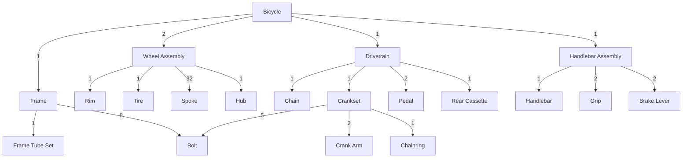

# Module 11: Bill of Materials & Roll-ups

**Level:** Advanced  |  **Time:** about 2.5 hours  |  **Files:** [`examples.sql`](examples.sql) · [`exercises.md`](exercises.md)

> The `CYCLE` clause used for the audit query needs **PostgreSQL 14 or newer**. Everything else works on older versions.

## Learning objectives

By the end of this module you can:

- read a bill of materials (BOM) and explain what "quantity per" means,
- **explode** an assembly into its raw parts, multiplying quantities down the levels,
- produce a **purchase list** by summing quantities across branches,
- roll a **cost** up through the levels, and check that it can be trusted,
- trace a part **upwards** to every assembly that uses it (where-used),
- avoid three silent traps: forgetting to multiply, `UNION` dropping rows, and a missing price lowering a total,
- audit a BOM for cycles.

---

## 11.1 What a bill of materials is

A BOM answers *"what is this product made of?"* It is stored in two tables:

| Table | Holds |
|---|---|
| `parts` | one row per part: `part_id`, `part_name`, `unit_cost` |
| `bom` | one row per component line: `assembly_id`, `component_id`, **`qty`** |

`qty` means **how many of the component go into ONE of the assembly**. It is *not* a total. The Wheel Assembly line "32 Spokes" means 32 spokes per wheel assembly.



| Term | Meaning here |
|---|---|
| **top-level item** | the finished product (Bicycle): not a component of anything |
| **assembly** | a part built from other parts (Frame, Wheel Assembly, Crankset...) |
| **raw part** (leaf) | a part nothing is built from (Spoke, Bolt...) |
| **level** | depth below the top-level item (Bicycle is level 0) |
| **extended (total) quantity** | how many are needed for the whole product |

Only raw parts have a price. Assemblies have `unit_cost = NULL`, because an assembly's cost **is** the cost of its contents.

## 11.2 A BOM is not quite a tree

In Module 9 every row had one parent. Here the **Bolt appears twice**: under the Frame (8) and under the Crankset (5). A part can have several parents, so the structure is a graph (specifically one with no cycles, since a part cannot contain itself). Two consequences:

- A **top-down traversal from the finished product still cannot loop**, as long as the data is valid.
- The same part is **reached by several routes**, so the answers must be **added up per part** at the end.

## 11.3 The explosion

An *explosion* lists everything a product contains, at every level. The recursion is Module 9's top-down template with one new idea: carry a **total quantity** that is **multiplied** at every step.

```sql
WITH RECURSIVE exploded(part_id, level, total_qty, path) AS (
    SELECT part_id, 0, 1, ARRAY[part_id]                    -- anchor: ONE unit of the top-level part
    FROM parts
    WHERE part_id = 1                                       -- 1 = Bicycle (change to explode another assembly)
    UNION ALL
    SELECT b.component_id,
           e.level + 1,
           e.total_qty * b.qty,                             -- MULTIPLY the quantity down the levels
           e.path || b.component_id
    FROM exploded e
    JOIN bom b ON b.assembly_id = e.part_id
    WHERE NOT (b.component_id = ANY (e.path))               -- safety net: a part cannot contain itself
)
SELECT e.level, p.part_name, e.total_qty, p.unit_cost
FROM exploded e
JOIN parts p ON p.part_id = e.part_id
ORDER BY e.path;
```

```
 level |     part_name      | total_qty | unit_cost
-------+--------------------+-----------+-----------
     0 | Bicycle            |         1 |
     1 | Frame              |         1 |
     2 | Bolt               |         8 |      0.10
     2 | Frame Tube Set     |         1 |     60.00
     1 | Wheel Assembly     |         2 |
     2 | Rim                |         2 |     18.00
     2 | Tire               |         2 |     12.00
     2 | Spoke              |        64 |      0.25
     2 | Hub                |         2 |     15.00
     1 | Drivetrain         |         1 |
     2 | Chain              |         1 |      9.00
     2 | Crankset           |         1 |
     3 | Bolt               |         5 |      0.10
     3 | Crank Arm          |         2 |     10.00
     3 | Chainring          |         1 |      8.00
     2 | Pedal              |         2 |      6.00
     2 | Rear Cassette      |         1 |     14.00
     1 | Handlebar Assembly |         1 |
     2 | Handlebar          |         1 |     11.00
     2 | Grip               |         2 |      2.00
     2 | Brake Lever        |         2 |      7.00
```

The key line is `e.total_qty * b.qty`. The Bicycle uses **2** Wheel Assemblies, each with **32** spokes, so the bicycle needs 2 x 32 = **64** spokes. Each level multiplies the one before it.

Sorting by `path` (an array of part ids, as in Module 9) gives outline order. Add indentation and you have the classic **indented BOM** that engineers read:

```
      indented_bom      | qty_per | total_qty
------------------------+---------+-----------
 Bicycle                |       1 |         1
     Frame              |       1 |         1
         Bolt           |       8 |         8
         Frame Tube Set |       1 |         1
     Wheel Assembly     |       2 |         2
         Rim            |       1 |         2
         Tire           |       1 |         2
         Spoke          |      32 |        64
         Hub            |       1 |         2
     Drivetrain         |       1 |         1
         Chain          |       1 |         1
         Crankset       |       1 |         1
             Bolt       |       5 |         5
             Crank Arm  |       2 |         2
             Chainring  |       1 |         1
         Pedal          |       2 |         2
         Rear Cassette  |       1 |         1
     Handlebar Assembly |       1 |         1
         Handlebar      |       1 |         1
         Grip           |       2 |         2
         Brake Lever    |       2 |         2
```

Read the two quantity columns together: `qty_per` is the line from the BOM (per parent), `total_qty` is what the whole product needs. Look at the Rim: 1 per wheel, but 2 in total.

## 11.4 The purchase list

A buyer does not want the assemblies. They want the **raw parts**, each with a **single total**. Two steps: keep only the raw parts (those that are not the assembly of any `bom` row), then **sum per part**:

```sql
SELECT p.part_id, p.part_name, SUM(e.total_qty) AS total_qty, p.unit_cost,
       SUM(e.total_qty * p.unit_cost) AS line_cost
FROM exploded e
JOIN parts p ON p.part_id = e.part_id
WHERE NOT EXISTS (SELECT 1 FROM bom x WHERE x.assembly_id = e.part_id)   -- raw parts only
GROUP BY p.part_id, p.part_name, p.unit_cost
ORDER BY p.part_id;
```

```
 part_id |   part_name    | total_qty | unit_cost | line_cost
---------+----------------+-----------+-----------+-----------
       6 | Rim            |         2 |     18.00 |     36.00
       7 | Tire           |         2 |     12.00 |     24.00
       8 | Spoke          |        64 |      0.25 |     16.00
       9 | Hub            |         2 |     15.00 |     30.00
      10 | Chain          |         1 |      9.00 |      9.00
      12 | Pedal          |         2 |      6.00 |     12.00
      13 | Rear Cassette  |         1 |     14.00 |     14.00
      14 | Handlebar      |         1 |     11.00 |     11.00
      15 | Grip           |         2 |      2.00 |      4.00
      16 | Brake Lever    |         2 |      7.00 |     14.00
      17 | Bolt           |        13 |      0.10 |      1.30
      18 | Frame Tube Set |         1 |     60.00 |     60.00
      19 | Crank Arm      |         2 |     10.00 |     20.00
      20 | Chainring      |         1 |      8.00 |      8.00
```

Look at the **Bolt**: 13 = 8 (under the Frame) + 5 (under the Crankset). The explosion produced two Bolt rows, and the `SUM` combined them. This is the same rule as in Module 4: **the recursion produces rows at the grain of "a part on a route"; summarise to the grain you need ("a part") afterwards.**

Reconcile the explosion with a few counts: 21 rows, 3 levels below the top, 14 raw part types, 96 raw units in total, 13 bolts. If a count ever surprises you, something upstream changed.

## 11.5 Trap 1: forgetting to multiply

What if the recursion keeps only each line's own `qty` and never multiplies? That is an easy slip to make: write `b.qty` instead of `e.total_qty * b.qty`.

```
 correct_cost | cost_if_you_forget_to_multiply | spokes_correct | spokes_if_you_forget_to_multiply
--------------+--------------------------------+----------------+----------------------------------
       259.30 |                         206.30 |             64 |                               32
```

Nothing errors. The Wheel Assembly is counted once instead of twice, so you under-order spokes (32 instead of 64) and under-cost the bicycle by 53.00 (one whole wheel). Only the numbers reveal it, so **always spot-check one deep quantity by hand** (2 wheels x 32 spokes = 64).

## 11.6 Trap 2: `UNION` silently drops rows

In Module 8 you learned that `UNION` removes duplicate rows. In a BOM that can silently destroy quantities. Suppose (as a test, rolled back) the Drivetrain *also* used 8 bolts. Then two different branches produce the **identical row** `(Bolt, 8)`, and `UNION` treats the second as a duplicate and discards it:

```
 bolts_with_union_all | bolts_with_union
----------------------+------------------
                   21 |               13
```

`UNION ALL` correctly gives 8 + 8 + 5 = 21. `UNION` gives **13**, and there is no error. Whenever rows from different branches can coincide, use **`UNION ALL`**, then aggregate on purpose.

## 11.7 Costing

### The cost of one bicycle

Only raw parts carry a price, so the cost is `SUM(total quantity x unit cost)` over the raw parts:

```
 bicycle_unit_cost
-------------------
            259.30
```

This matches the 14 line costs in the purchase list.

### The rolled-up cost of every assembly

What does a Frame cost? A Drivetrain? Run the explosion for **every assembly at once** with a **closure**, the idea from Module 9: pair each assembly (the *root*) with all its raw parts and their multiplied quantities.

```sql
WITH RECURSIVE closure(root_id, part_id, total_qty) AS (       -- every assembly as its own root
    SELECT assembly_id, component_id, qty
    FROM bom                                                   -- anchor: every direct component line
    UNION ALL
    SELECT c.root_id, b.component_id, c.total_qty * b.qty      -- multiply down, keeping the root
    FROM closure c
    JOIN bom b ON b.assembly_id = c.part_id
),
rolled_up AS (                                                 -- grain: one row per assembly
    SELECT r.part_id, r.part_name, SUM(c.total_qty * p.unit_cost) AS unit_cost
    FROM closure c
    JOIN parts r ON r.part_id = c.root_id
    JOIN parts p ON p.part_id = c.part_id
    GROUP BY r.part_id, r.part_name
)
SELECT part_id, part_name, ROUND(unit_cost, 2) AS rolled_up_unit_cost
FROM rolled_up
ORDER BY part_id;
```

```
 part_id |     part_name      | rolled_up_unit_cost
---------+--------------------+---------------------
       1 | Bicycle            |              259.30
       2 | Frame              |               60.80
       3 | Wheel Assembly     |               53.00
       4 | Drivetrain         |               63.50
       5 | Handlebar Assembly |               29.00
      11 | Crankset           |               28.50
```

Check it by hand: the Bicycle is 1 Frame + 2 Wheel Assemblies + 1 Drivetrain + 1 Handlebar Assembly = 60.80 + 2 x 53.00 + 63.50 + 29.00 = **259.30**. Two independent routes to the same number is strong evidence that the quantities and the roll-up are right, and the exercise asks you to compute exactly that cross-check.

### Make sure the cost can be trusted

A cost is only as good as the data. Before relying on it, run these counts (they should be 0, 0, 1 and 0):

```
 assemblies_with_a_price | raw_parts_without_price | top_level_parts | parts_in_no_bom
-------------------------+-------------------------+-----------------+-----------------
                       0 |                       0 |               1 |               0
```

- **assemblies with a price**: if an assembly had its own price, it would be **counted twice** (once itself, once through its contents).
- **raw parts without a price**: see the next trap.
- **top-level parts**: exactly one finished product.
- **parts in no BOM**: parts nobody uses and nothing contains (orphans).

### Trap 3: a missing price lowers the total, silently

`SUM` ignores `NULL`. Take away the Hub's price (inside a rolled-back transaction) and rerun the cost:

```
 total_cost_that_looks_fine | raw_parts_without_price
----------------------------+-------------------------
                     229.30 |                       1
```

The total dropped from 259.30 to 229.30 with no error, because the two Hubs (30.00) vanished from the sum. The only warning is the check count `raw_parts_without_price = 1`. **Always report that count alongside any cost**, or make the query fail when it is not zero.

## 11.8 Where-used: tracing a part upwards

*Where is the Bolt used?* This is the reverse of an explosion: start at the part and walk **up** through the assemblies that contain it. It is essential when a supplier recalls a part ("which products contain it?"). Multiply quantities on the way up as well:

```sql
WITH RECURSIVE used_in(assembly_id, levels_up, bolts, route, path) AS (
    SELECT b.assembly_id, 1, b.qty, 'Bolt < ' || a.part_name, ARRAY[b.component_id, b.assembly_id]
    FROM bom b
    JOIN parts a ON a.part_id = b.assembly_id
    WHERE b.component_id = 17                               -- 17 = Bolt: the part we are tracing upwards
    UNION ALL
    SELECT b.assembly_id,
           u.levels_up + 1,
           u.bolts * b.qty,                                 -- multiply UP as well: bolts per one unit of the parent
           u.route || ' < ' || a.part_name,
           u.path || b.assembly_id
    FROM used_in u
    JOIN bom   b ON b.component_id = u.assembly_id          -- the join runs the other way
    JOIN parts a ON a.part_id      = b.assembly_id
    WHERE NOT (b.assembly_id = ANY (u.path))
)
SELECT levels_up, route, bolts FROM used_in ORDER BY levels_up, assembly_id, bolts;
```

```
 levels_up |                 route                  | bolts
-----------+----------------------------------------+-------
         1 | Bolt < Frame                           |     8
         1 | Bolt < Crankset                        |     5
         2 | Bolt < Frame < Bicycle                 |     8
         2 | Bolt < Crankset < Drivetrain           |     5
         3 | Bolt < Crankset < Drivetrain < Bicycle |     5
```

The Bicycle appears **twice**, because it reaches the Bolt by two routes: through the Frame (8 bolts) and through the Drivetrain and Crankset (5 bolts). Summing per assembly gives the number of bolts in **one unit** of each:

```
 part_id | part_name  | bolts_per_unit | routes
---------+------------+----------------+--------
       1 | Bicycle    |             13 |      2
       2 | Frame      |              8 |      1
       4 | Drivetrain |              5 |      1
      11 | Crankset   |              5 |      1
```

**Cross-check:** walking *up* from the Bolt finds 13 bolts in a Bicycle, and exploding *down* from the Bicycle also finds 13. Two directions, one answer.

| | Explosion | Where-used |
|---|---|---|
| Direction | down, from an assembly to its parts | up, from a part to its assemblies |
| Anchor | the assembly | the part |
| Recursive join | `b.assembly_id = e.part_id` | `b.component_id = u.assembly_id` |
| Answers | "what do I need to build this?" | "where is this part used?" |

## 11.9 Cycles: a part cannot contain itself

A valid BOM has no cycles. A cycle (the Bolt "contains" the Bicycle) is a data error, but one that can happen when someone mistypes a part number. Try it in a rolled-back transaction and run the explosion with **no** guard:

```
 unguarded_explosion_with_a_cycle
----------------------------------
 22003: integer out of range
```

It does **not** hang, and the error message does not mention a cycle. What happens: every trip round the loop **multiplies** the quantity (here by 8), so it overflows an `integer` after about 30 rounds (roughly ten trips round the loop, in my test). A confusing `integer out of range` in a BOM query should make you suspect a cycle. The path check in the explosion template (`NOT (b.component_id = ANY (e.path))`) prevents this.

To **find** cycles in the data, use a **BOM audit**: pair every part with everything below it and let `CYCLE` (PostgreSQL 14+) flag any part that reappears on its own path:

```sql
WITH RECURSIVE reach(root_id, part_id) AS (
    SELECT part_id, part_id FROM parts
    UNION ALL
    SELECT r.root_id, b.component_id FROM reach r JOIN bom b ON b.assembly_id = r.part_id
)
CYCLE part_id SET is_cycle USING path
SELECT COUNT(*) FILTER (WHERE is_cycle) AS cycle_rows_found FROM reach;
```

On the real BOM it returns **0**. With the cycle injected it returns **10** (several starting points run into the loop). What matters is zero against non-zero. Run an audit like this whenever the BOM is edited.

## 11.10 What a real BOM adds

This module keeps the model small. Production BOMs also carry things not modelled here:

| Real-world feature | Why it matters |
|---|---|
| **Revisions and effective dates** | the BOM changes over time; costs must use the version in force |
| **Alternates and substitutes** | a part may have approved replacements |
| **Scrap and yield factors** | you must buy more than the net quantity |
| **Units of measure** | metres, litres and "each" cannot be added together |
| **Phantom assemblies** | sub-assemblies that are never stocked, only exploded through |
| **Multiple plants or suppliers** | the same part has different costs in different places |

The recursive structure stays the same. What changes is the extra filtering (for example `WHERE effective_date <= :date`) and the extra multipliers (such as `* (1 + scrap_rate)`).

## Common mistakes

| Mistake | Symptom | Fix |
|---|---|---|
| `b.qty` instead of `e.total_qty * b.qty` | Quantities and costs too low, no error (206.30 instead of 259.30) | Multiply down; spot-check one deep quantity by hand |
| `UNION` instead of `UNION ALL` | Identical rows from different branches vanish (13 instead of 21 bolts) | `UNION ALL`, then aggregate |
| Reading the raw explosion rows as the purchase list | Same part listed several times, assemblies included | Keep raw parts only, then `SUM` per part |
| Not summing per part | Bolt shows as two lines (8 and 5) | `GROUP BY part`, `SUM(total_qty)` |
| A raw part with no price | Total silently too low (229.30) | Report `raw_parts_without_price`, or fail when it is not zero |
| An assembly with its own price | Cost counted twice | Check `assemblies_with_a_price = 0` |
| No cycle guard | `integer out of range`, or a runaway query | Path check, plus a BOM audit |
| Forgetting to multiply on the way up in where-used | Wrong consumption per assembly | `u.bolts * b.qty` |
| Treating `qty` as a total | Wrong by a factor at every level | `qty` is per **one** parent unit |

## Key takeaways

- A BOM line's `qty` is **per one assembly**. An explosion **multiplies** it down the levels.
- Shared parts make the structure a graph: **sum per part** at the end, and use **`UNION ALL`**.
- The purchase list is the **raw parts** only, aggregated by part.
- **Roll up cost** with a closure; assemblies are unpriced, raw parts are priced.
- The cost is only trustworthy after checking **no assembly has a price** and **no raw part is missing one**, because a `NULL` price lowers the total silently.
- **Where-used** is the explosion in reverse: join the other way, multiply upwards, cross-check against the explosion.
- A BOM must be **acyclic**. A cycle shows up as an odd `integer out of range` error; audit with `CYCLE`.

## Checkpoint

<details>
<summary>1. The Bicycle uses 2 Wheel Assemblies, and each uses 32 Spokes. How does the recursion get 64, and what goes wrong if it does not multiply?</summary>

The recursive step carries `total_qty` and computes `e.total_qty * b.qty`, so the spokes are 2 x 32 = 64. Without multiplying, each line contributes only its own `qty`, giving 32 spokes and a cost too low by one whole wheel, with no error.
</details>

<details>
<summary>2. The Bolt is used under the Frame (8) and the Crankset (5). How do you get one line of 13 for the purchase list?</summary>

The explosion produces one Bolt row per route (8 and 5). Keep only the raw parts and `SUM(total_qty)` grouped by part to combine them into 13.
</details>

<details>
<summary>3. Why can using <code>UNION</code> instead of <code>UNION ALL</code> under-count a part?</summary>

If two branches produce the identical row (same part, same quantity), `UNION` treats them as duplicates and removes one, so a quantity disappears silently. `UNION ALL` keeps every row, and you aggregate afterwards.
</details>

<details>
<summary>4. A total cost drops from 259.30 to 229.30 after a price update and no error appears. What is the likely cause, and how do you guard against it?</summary>

A raw part lost its price (`NULL`), and `SUM` ignores `NULL`. Always report the count of raw parts with no price next to the cost, or make the query fail when that count is not zero.
</details>

**Next:** do the [exercises](exercises.md), then continue to [Module 12: Data-Modifying CTEs](../12-data-modifying-ctes/lesson.md).
