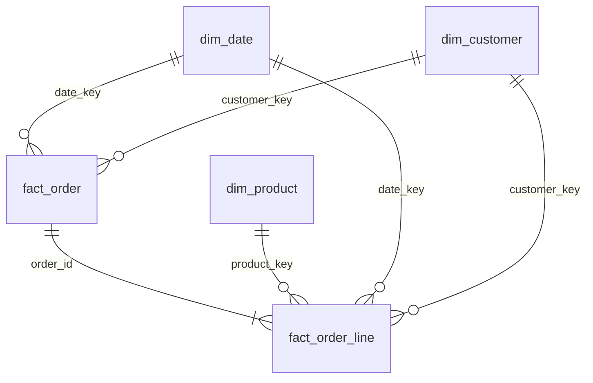
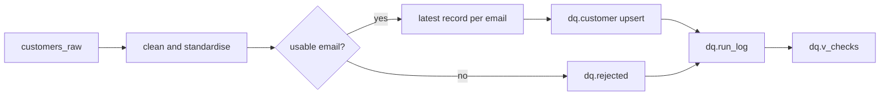

# Module 14: Capstone Portfolio Projects

**Level:** Advanced  |  **Time:** about 8 hours (two hours per project)  |  **Files:** [`examples.sql`](examples.sql) · [`exercises.md`](exercises.md) · reference deliverables [`14-01.sql`](14-01.sql) to [`14-04.sql`](14-04.sql) · portfolio READMEs in [`projects/`](projects/)

## What this module is for

The first thirteen modules taught techniques. This one turns them into **four finished projects** that you can publish on GitHub and talk about in an interview. A hiring manager rarely cares that you know what a CTE is. They care whether you can **take a messy business need and deliver something correct, tested and documented**.

So every project here is built to the same professional standard, and that standard is the real lesson.

## 14.1 What a reviewer looks for

| They look for | How these projects show it |
|---|---|
| A clear problem | each project starts from a business need, in one paragraph |
| **Correct numbers** | every deliverable ends with **self-checks** that reconcile against an independent total |
| Sensible design | grains are stated, keys enforced, trade-offs written down |
| **Testing** | the SQL runs in CI on PostgreSQL 14, 16 and 17 and its output is compared line by line |
| Safety | everything runs inside `BEGIN ... ROLLBACK`, and the runner fails if the practice data changes |
| Honesty | each README lists the **limitations** and what you would do next |
| Communication | a README a stranger can follow in five minutes |

## 14.2 The four projects

| # | Project | Business need | Techniques | Reference file |
|---|---|---|---|---|
| 1 | **Sales analytics mart** | Analysts want revenue, orders, categories and customers without rewriting joins | star schema, two fact grains, aggregate-then-join, windows, enforced keys, indexes | [`14-01.sql`](14-01.sql) |
| 2 | **Org-chart explorer** | HR wants to see who manages whom, team sizes and cost, and be warned when the data is broken | recursive view, closure, function, integrity audit | [`14-02.sql`](14-02.sql) |
| 3 | **Data-quality pipeline** | Messy customer records arrive repeatedly and must end up clean, with nothing silently lost | cleaning, de-duplication, upsert, quarantine, audit log, automated checks | [`14-03.sql`](14-03.sql) |
| 4 | **Route planner** | List the possible routes between two cities and know what is impossible | path enumeration, cycle control, budgets, benchmarks, stating the limits | [`14-04.sql`](14-04.sql) |

I would build **Projects 1 and 3 first**, in depth. They map most directly onto analyst and data-engineering roles, and they are the ones a Power BI or Tableau dashboard or a pipeline discussion can hang from. Projects 2 and 4 are compact but complete, and they show range.

## 14.3 The standard every project follows

### One schema per project

Each project builds in its own PostgreSQL **schema** (`mart`, `org`, `dq`, `routing`) so it never collides with other work, can be documented with `COMMENT`, and can be dropped in one statement. [`examples.sql`](examples.sql) shows the pattern and a query that generates a **data dictionary** straight from the catalog:

```
    table_name    |  column_name  | data_type | is_nullable |                     description
------------------+---------------+-----------+-------------+-----------------------------------------------------
 customer_summary | customer_key  | integer   | NO          |
 customer_summary | customer_name | text      | YES         |
 customer_summary | country       | text      | YES         |
 customer_summary | orders        | bigint    | YES         | All statuses; zero for customers who never ordered.
```

(Paste a query like this into a README instead of typing a data dictionary by hand: it cannot drift from the real tables.)

### The self-check table

Every deliverable ends with a table of checks. Each row has a **name**, an **expected** value computed *independently*, the **actual** value, and a **passed** flag:

```
                               check_name                                | expected  |  actual   | passed
-------------------------------------------------------------------------+-----------+-----------+--------
 completed revenue matches the base tables (independent control total)   | 184254.90 | 184254.90 | t
 shipping is counted once per order (no fan-out)                         | 870.00    | 870.00    | t
```

This is the most valuable habit in the course. It turns "I think it is right" into evidence, it is what you run again after every change, and `examples.sql` shows how to make it **fail loudly** (an assertion that raises an error when any check is false) so a scheduled job or CI cannot ignore a wrong number.

### Safe to run, safe to keep

In this repository each file runs inside `BEGIN ... ROLLBACK`, so the tests can run it a thousand times and the practice data never changes. In **your own** project repository, delete the `BEGIN;` and `ROLLBACK;` lines and run the file once to keep the objects. (Each file's header says so.)

## 14.4 Project 1: the sales analytics mart

**The design.** A *star schema*: descriptive **dimension** tables around numeric **fact** tables.



The key decision is **two fact tables at two grains**:

| Table | Grain (one row per...) | Holds |
|---|---|---|
| `fact_order_line` | order line | quantity, gross, discount, net amount |
| `fact_order` | order | shipping fee, line count, units, net amount |

`shipping_fee` belongs to the order, so it lives in `fact_order`. Put it in the line table and every report that sums it would be **wrong** (2,110.00 instead of 870.00, the fan-out from Module 4). One table per grain makes that mistake impossible. `fact_order` is built by summarising lines **first** and then joining (aggregate, then join).

**What it contains** (from the reference run):

```
    table_name    | row_count | columns |                          description
------------------+-----------+---------+----------------------------------------------------------------
 dim_date         |       546 |       9 | One row per calendar day between the first and last order.
 dim_customer     |        30 |       6 | One row per customer. first_order_date is NULL for customers who never ordered.
 dim_product      |        20 |       6 | One row per product with its full category path and top-level category.
 fact_order_line  |       286 |      12 | GRAIN: one row per order line. Sum net_amount freely; ...
 fact_order       |       120 |       8 | GRAIN: one row per order. shipping_fee lives here, at its own grain.
```

Design points worth explaining in an interview:

- **The calendar runs from the first to the last order** (taken from the data), so there are no invented empty months (Module 8).
- **`dim_product` flattens the category tree** with a recursive CTE into a readable path and a top-level category (Module 9), so a BI tool needs no recursion.
- **Foreign keys are enforced**, so the database refuses orphan facts. **Indexes are added by hand** on the fact tables' key columns, because PostgreSQL does not index foreign keys automatically (Module 13).
- **Amounts are stored unrounded**, and the KPI views round for presentation, so totals always add up.
- **`kpi_monthly` joins to a month calendar** so a month with no sales shows zero instead of vanishing, which protects the `LAG` growth calculation (Modules 5 and 8).

**The KPI views** (what a dashboard reads):

```
 month_start | completed_orders | net_revenue | mom_growth_pct | running_revenue
-------------+------------------+-------------+----------------+-----------------
 2025-01-01  |                2 |     9273.25 |                |         9273.25
 2025-02-01  |                5 |    10878.35 |           17.3 |        20151.60
 2025-03-01  |                8 |    25668.60 |          136.0 |        45820.20
 2025-04-01  |                2 |     6646.00 |          -74.1 |        52466.20

 top_category | net_revenue | units | pct_of_total
--------------+-------------+-------+--------------
 Electronics  |   148555.50 |   363 |         80.6
 Office       |    35699.40 |   230 |         19.4
```

**The proof.** Eleven self-checks, all `t`, including: completed revenue **184,254.90** equals an independent total from the base tables; order-grain and line-grain net revenue agree (268,482.40); shipping totals **870.00**; the category KPI adds up to the revenue; and March 2025 growth is 136.0 percent, the same figure you calculated in Module 5.

**Connecting a BI tool.** Point Power BI or Tableau at the `mart` schema. Relate each fact to its dimensions on the `*_key` columns, treat `dim_date` as the date table, and build measures from `net_amount` (filtered to `status = 'completed'` where you want completed revenue). The exact clicks differ between tool versions, so follow your tool's documentation, and **reconcile the dashboard's total against 184,254.90** before you trust it. That reconciliation is the part worth putting in your README.

## 14.5 Project 2: the org-chart explorer

A recursive view plus a function and an audit, on the employee hierarchy.

| Object | Purpose |
|---|---|
| `org.v_org_chart` | every employee with depth, chain of managers, direct and total reports, team payroll |
| `org.v_level_stats` | headcount and pay per level |
| `org.team(manager)` | function: everyone below a manager |
| `org.v_audit` | integrity audit: employees total, reached, roots, unreachable |

The managers' scorecard in outline order, from the reference run (14 managers; the first rows):

```
         manager         | direct_reports | total_reports | team_payroll
-------------------------+----------------+---------------+--------------
 Amina Hassan            |              5 |            29 |   2850000.00
     Brian Otieno        |              2 |             7 |    757000.00
         Grace Wanjiru   |              3 |             3 |    329000.00
         Hassan Ali      |              2 |             2 |    263000.00
     Carla Mendes        |              2 |             6 |    564000.00
 ...
     Farid Rahman        |              1 |             6 |    612000.00
         Mohamed Yusuf   |              4 |             5 |    452000.00
             Zane Ochieng|              1 |             1 |    121000.00
```

Headcount and pay per level, and the audit:

```
 depth | people | avg_salary |   payroll
-------+--------+------------+------------
     1 |      1 |  250000.00 |  250000.00
     2 |      5 |  158000.00 |  790000.00
     3 |      7 |   98571.43 |  690000.00
     4 |     16 |   67375.00 | 1078000.00
     5 |      1 |   42000.00 |   42000.00

 employees_total | employees_reached | roots | unreachable_employees
-----------------+-------------------+-------+-----------------------
              30 |                30 |     1 |                     0
```

Design points: the closure that computes headcounts carries a **depth guard** (`distance < 20`) as a safety net against a cycle in bad data (Module 9). The audit is not decoration. Break the data on purpose (employees 14 and 15 made each other's manager) and it reports **28 reached, 2 unreachable**, exactly the problem you would want HR to hear about. The eight self-checks include a cross-check with Module 12: the team payroll of the VP of Data (**612,000.00**) equals the Data and Analytics department payroll, computed by a completely different route.

## 14.6 Project 3: the data-quality pipeline



The pipeline is **one statement** (a chain of data-modifying CTEs, Module 12) that cleans, loads, quarantines and logs **atomically**: either everything in a run happens, or none of it does.

| Object | Purpose |
|---|---|
| `dq.customer` | clean customers, one per email (the key) |
| `dq.rejected` | quarantine: rows with a missing or malformed email, with the **reason** and the original raw values |
| `dq.run_log` | one row per run: raw rows, rows loaded or updated, duplicates seen, newly quarantined |
| `dq.run_pipeline()` | the single statement |
| `dq.v_checks` | automated checks |

**The policy is written down** (a senior habit): the **latest record per email wins** (a newer record updates the stored row), a **blank name is allowed but reported**, and a **missing or malformed email is quarantined**, never dropped silently.

Three runs: the first, an immediate second run with nothing new, and a third after a **late-arriving, newer record** for an existing customer:

```
 raw_rows | loaded_or_updated_rows | duplicate_rows | rejected_rows
----------+------------------------+----------------+---------------
       20 |                     12 |              6 |             2
       20 |                      0 |              6 |             0
       21 |                      1 |              7 |             0
```

- **Run 1 reconciles:** 20 raw rows = 12 loaded + 6 duplicates + 2 rejected.
- **Run 2 changes nothing:** the load is idempotent, so a retry is safe.
- **Run 3 updates exactly one row** (Alice's record becomes `Alice Mwangi-Otieno`), because the new record is newer.

The quarantine keeps the evidence:

```
 raw_id |     reason      |       raw_email       |   raw_name
--------+-----------------+-----------------------+---------------
     10 | malformed email | 'farah.ahmed@example' | 'Farah Ahmed'
     11 | missing email   | NULL                  | 'George Ouma'
```

**The checks** (seven, all passing) cover: no duplicate, malformed or missing emails in the clean table; every quarantined row has a reason; one customer per distinct valid email; run 1 reconciles; run 2 changed nothing. Then the tamper test: someone inserts a bad row **directly** into the clean table, bypassing the pipeline, and **two checks fail** (no malformed emails; one customer per distinct valid email). A pipeline whose checks can fail is a pipeline you can trust when they pass.

## 14.7 Project 4: the route planner

`routing.plan_route(from, to, max_km)` lists every simple route, shortest first, with a **path check** for cycle control and an optional **distance budget** for pruning (Module 10). `routing.v_shortest` gives the shortest distance for every ordered pair of cities.

```
                     route                     | total_km | hops
-----------------------------------------------+----------+------
 Nairobi > Nakuru > Eldoret > Kampala > Kigali |     1220 |    4
 Nairobi > Nakuru > Kisumu > Kampala > Kigali  |     1230 |    4
```

The network: 72 ordered city pairs, **64 reachable** (no road leaves Kigali, so 8 pairs are impossible), and the longest shortest route is **2,730 km** (Arusha to Kigali).

**The most important section of this project is its limits.** The function builds *every* simple route, so its cost grows **exponentially**. The benchmark uses a ladder graph (2 nodes per layer, every node linked to both nodes of the next layer):

```
 layers |  paths
--------+--------
     12 |   2048
     14 |   8192
     16 |  32768
     18 | 131072
```

Every two extra layers multiplies the work by **4** (a self-check proves it). A project README that says "this is right for a small network, and here is exactly where it stops being right, and what to use instead (Dijkstra in application code, or the pgRouting extension)" shows more engineering maturity than one that claims it scales.

## 14.8 Packaging for GitHub

Each project has a portfolio-ready README in [`projects/`](projects/), written from the verified results. Use [`projects/README_TEMPLATE.md`](projects/README_TEMPLATE.md) for your own, and run through [`projects/PORTFOLIO_CHECKLIST.md`](projects/PORTFOLIO_CHECKLIST.md) before you publish. The bones of a good project README:

1. **The problem** in one paragraph.
2. **What it demonstrates** (the skills, honestly).
3. **Design and decisions**, including trade-offs and the grain of every table.
4. **How to run it**, in three commands.
5. **Results**, with real output.
6. **How it is tested** (the self-checks, and CI).
7. **Limitations** and **what you would do next**.

### Describing it on a CV or LinkedIn

Only claim what you built and can explain. Examples of honest, specific bullets (adapt them to what you actually did):

- *Designed a PostgreSQL star schema with two fact tables at different grains and enforced keys; revenue reconciles to the cent against the source tables through 11 automated checks.*
- *Built an idempotent data-quality pipeline as a single atomic SQL statement, with a quarantine table, a run log and automated checks that fail when the data is tampered with.*
- *Documented the limits of a recursive route planner with an exponential-growth benchmark, and the alternatives (Dijkstra, pgRouting).*

Never list a tool you did not use. If you connected Power BI, say so and show the dashboard. If you did not, say "BI-ready" rather than "built dashboards".

## 14.9 Going further

These extensions would make strong portfolio additions, and none of them is done for you:

- a **front end** for Project 2 (a Power BI hierarchy, or a small web page that renders the tree),
- **scheduling** Project 3's pipeline and sending its failed checks somewhere a human will see them,
- a **dashboard** on Project 1, with the 184,254.90 reconciliation shown in the README,
- a **pgRouting** version of Project 4, compared with the recursive CTE on a larger graph.

## Key takeaways

- A project is **finished** when it is correct, tested and documented, not when it runs once.
- **Self-checks** with independently computed expected values are the best evidence of correctness, and they can be made to fail loudly.
- **State the grain** of every table, **write the policy** down, and keep **limitations** in the README.
- Run everything **safely** (`BEGIN ... ROLLBACK` while developing, a schema per project) and keep it **reproducible** (CI on several PostgreSQL versions).
- Claim only what you built, and be ready to explain every line.

## Checkpoint

<details>
<summary>1. Why does the sales mart have two fact tables instead of one?</summary>

Because `shipping_fee` belongs to the order, not to each line. In a single line-grain table every order's fee would repeat once per line, and any report summing it would overcount (2,110.00 instead of 870.00). One table per grain makes that error impossible.
</details>

<details>
<summary>2. What does it mean that the data-quality pipeline is idempotent, and how do you know?</summary>

Running it again on unchanged data changes nothing, so a retry after a failure is safe. The second run's log shows 0 rows loaded or updated, and a check asserts that.
</details>

<details>
<summary>3. A self-check table passes. Why might that still not be enough?</summary>

A check is only as good as its *expected* value. If the expected value is computed the same way as the actual value, the check proves nothing. The best expected values come from an independent route (a control total from the base tables, a cross-check with another module).
</details>

<details>
<summary>4. Your route planner is fast on 9 cities. What must the README say about a network of a million roads?</summary>

That it enumerates every simple route, so its cost grows exponentially and it is only suitable for small networks, and that a shortest-path algorithm (Dijkstra in application code, or pgRouting) is the right tool for large ones. The benchmark (4 times the work for every 2 extra layers) is the evidence.
</details>

**You have reached the end of the course.** Do the [exercises](exercises.md) to build the projects yourself, then publish them.
