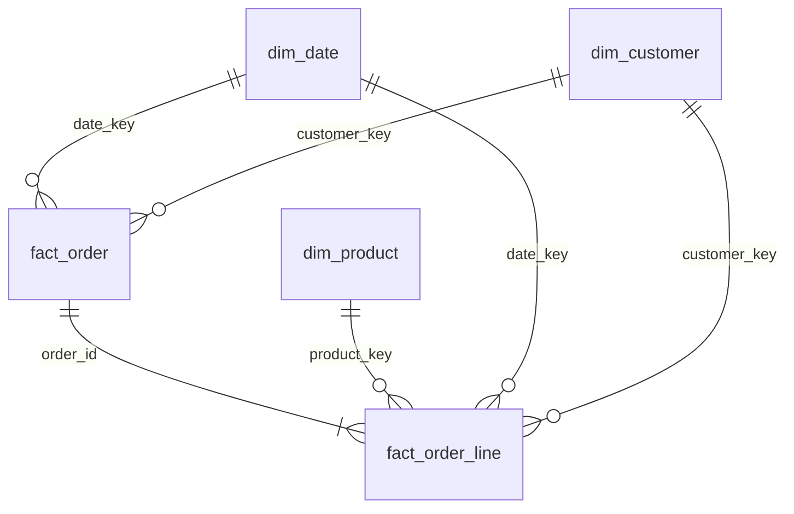

# Sales analytics mart: a PostgreSQL star schema ready for Power BI or Tableau

> **This README is a model.** It is written from the reference solution so you can see the level to aim for. When you build your own project, rewrite it in your own words and keep only the claims that are true of **your** work.

## The problem

Analysts keep rewriting the same joins over orders, order lines, products, categories and customers, and they sometimes get different totals. This project builds a **reporting mart**: a small star schema with agreed definitions, so every dashboard reads the same numbers.

## What this project demonstrates

- A **star schema** with three dimensions and **two fact tables at different grains**, and why that matters (it prevents double-counting an order-level fee).
- **Aggregate, then join**, to build the order-level fact without repeating the line-level amounts.
- A **recursive CTE** to flatten a category tree into a path and a top-level category.
- **Enforced keys** and **indexes** chosen by hand (PostgreSQL does not index foreign keys automatically).
- KPI views using **window functions**, protected against missing months by a calendar.
- **Eleven self-checks** that reconcile the mart to the source tables.

## Design



| Table | Grain (one row per...) | Rows |
|---|---|---|
| `dim_date` | calendar day, first to last order | 546 |
| `dim_customer` | customer | 30 |
| `dim_product` | product, with category path and top-level category | 20 |
| `fact_order_line` | order line | 286 |
| `fact_order` | order (holds the shipping fee) | 120 |

**Decisions**

- **Two fact tables.** `shipping_fee` belongs to the order. In a single line-grain table it would repeat once per line and any report summing it would be wrong (2,110.00 instead of 870.00). One table per grain makes the mistake impossible.
- **The calendar is bounded by the data**, not by a fixed year, so there are no invented empty months.
- **Amounts are stored unrounded**; the KPI views round, so totals always add up.
- **`kpi_monthly` starts from a month calendar** and `LEFT JOIN`s the sales, so a month with no sales shows `0` and the growth calculation never compares across a gap.

## How to run it

```bash
psql -d your_database -f 14-capstones/14-01.sql
```

In this repository the file runs inside `BEGIN ... ROLLBACK`. To **keep** the `mart` schema, delete those two lines in your own copy. Requires PostgreSQL 14 or newer.

## Results

```
 month_start | completed_orders | net_revenue | mom_growth_pct | running_revenue
-------------+------------------+-------------+----------------+-----------------
 2025-01-01  |                2 |     9273.25 |                |         9273.25
 2025-02-01  |                5 |    10878.35 |           17.3 |        20151.60
 2025-03-01  |                8 |    25668.60 |          136.0 |        45820.20
 2025-04-01  |                2 |     6646.00 |          -74.1 |        52466.20

 top_category | net_revenue | units | pct_of_total
--------------+-------------+-------+--------------
 Electronics  |   148555.50 |   363 |         80.6
 Office       |    35699.40 |   230 |         19.4
```

## How it is tested

The file ends with a **self-check table**; every row must show `passed = t`. The expected values come from **independent routes**, not from the mart itself:

| Check | Expected |
|---|---|
| completed revenue equals a control total from the base tables | 184254.90 |
| order grain and line grain agree on total net revenue | 268482.40 |
| shipping is counted once per order | 870.00 |
| the category KPI adds up to the completed revenue | 184254.90 |
| the monthly KPI covers every month; March 2025 growth | 18 months; 136.0 |
| the running total ends at the completed revenue | 184254.90 |

CI runs the file on PostgreSQL 14, 16 and 17 and compares its output line by line.

## Connecting a BI tool

Point Power BI or Tableau at the `mart` schema, relate each fact table to its dimensions on the `*_key` columns, and mark `dim_date` as the date table. Build measures from `net_amount`, filtered to `status = 'completed'` where you want completed revenue. **Reconcile the dashboard total against 184,254.90** before you trust it. (Follow your tool's documentation for the exact steps; they differ between versions.)

## Limitations

- The mart is rebuilt from scratch; there is **no incremental load** and no history of changes (no slowly changing dimensions).
- `dim_customer` records only the current attributes of each customer.
- The data is a small synthetic set; the design choices are right at this size, but nothing here has been load-tested on millions of rows.

## What I would do next

- An **incremental load** driven by a change marker on the source tables.
- A **dashboard** on top of the mart, with the reconciliation shown on the page.
- A check that compares the mart with the source on a **schedule** and alerts when they diverge.

## Skills used

Star-schema design and grain ([Module 4](../../../04-aggregation-patterns/lesson.md)), window functions ([5](../../../05-window-functions/lesson.md)), recursive CTEs ([8](../../../08-recursive-basics/lesson.md) and [9](../../../09-hierarchies/lesson.md)), indexing and review habits ([13](../../../13-best-practices/lesson.md)). Reference solution: [`14-01.sql`](../../14-01.sql).
