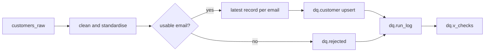

# Data-quality pipeline: clean, quarantine, log and check, in one atomic statement

> **This README is a model.** Rewrite it in your own words, and keep only the claims that are true of **your** project.

## The problem

Customer records arrive messy (stray spaces, mixed case, blanks, malformed or missing emails, the same person loaded several times) **and they arrive repeatedly**. The business needs a clean customer table, but also needs to know **what was rejected and why**, that a re-run is safe, and that nothing is silently lost.

## What this project demonstrates

- **Cleaning and de-duplication** with a CTE pipeline: standardise, classify, rank.
- **One atomic statement** of data-modifying CTEs that loads, quarantines and logs together: it either fully happens or not at all.
- An **idempotent upsert** with a "latest record wins" rule.
- A **quarantine** that keeps the original raw values and the reason.
- A **run log** and **automated checks** that can fail, proved by a tamper test.



## Design

| Object | Purpose |
|---|---|
| `dq.customer` | clean customers; **email is the primary key** |
| `dq.rejected` | quarantine: `raw_id`, the **reason**, and the original raw values |
| `dq.run_log` | one row per run: raw rows, loaded or updated, duplicates seen, newly quarantined |
| `dq.run_pipeline()` | the single statement |
| `dq.v_checks` | automated checks |

**The policy (written down on purpose).** The **latest record per email wins**; a **blank name is allowed but reported**; a **missing or malformed email is quarantined**, never dropped silently.

## How to run it

```bash
psql -d your_database -f 14-capstones/14-03.sql
```

To keep the `dq` schema, delete the `BEGIN;` and `ROLLBACK;` lines in your copy. Requires PostgreSQL 14 or newer.

## Results

Three runs: the first; an immediate second run with nothing new; and a third after a **newer record** for an existing email arrives.

```
 raw_rows | loaded_or_updated_rows | duplicate_rows | rejected_rows
----------+------------------------+----------------+---------------
       20 |                     12 |              6 |             2
       20 |                      0 |              6 |             0
       21 |                      1 |              7 |             0
```

- Run 1 **reconciles**: 20 = 12 + 6 + 2.
- Run 2 changes **nothing**: the load is idempotent, so a retry is safe.
- Run 3 updates **exactly one row**: the late record is newer, so it wins.

The quarantine keeps the evidence:

```
 raw_id |     reason      |       raw_email       |   raw_name
--------+-----------------+-----------------------+---------------
     10 | malformed email | 'farah.ahmed@example' | 'Farah Ahmed'
     11 | missing email   | NULL                  | 'George Ouma'
```

## How it is tested

Seven checks, all `t`: no duplicate, malformed or missing emails in the clean table; every quarantined row has a reason; one customer per distinct valid email in the raw data (an **independent** count); run 1 reconciles; run 2 changed nothing.

**The tamper test.** A bad row is inserted **directly** into the clean table, bypassing the pipeline. **Two checks fail** (no malformed emails; one customer per distinct valid email). A set of checks that cannot fail would prove nothing; this proves they can.

## Limitations

- The email check is a **sanity pattern**, not full email validation: it does not prove a mailbox exists.
- "Latest wins" is a policy. It loses information if a newer record is *worse* (for example a blank name overwriting a good one). A field-level merge would be the next refinement.
- It handles **one source** and one entity (customers).
- It is a **batch** process: it processes the whole raw table each run, which is fine at this size and would need an incremental design at scale.

## What I would do next

- **Profile** each raw column (nulls, blanks, patterns) in a view.
- A **survivorship rule** that merges fields instead of taking the whole latest record.
- **Schedule** the pipeline and route failed checks to a person.

## Skills used

Cleaning and de-duplication ([Module 6](../../../06-data-cleaning/lesson.md)), data-modifying CTEs, upsert and atomicity ([12](../../../12-data-modifying-ctes/lesson.md)), reconciliation ([4](../../../04-aggregation-patterns/lesson.md)). Reference solution: [`14-03.sql`](../../14-03.sql).
